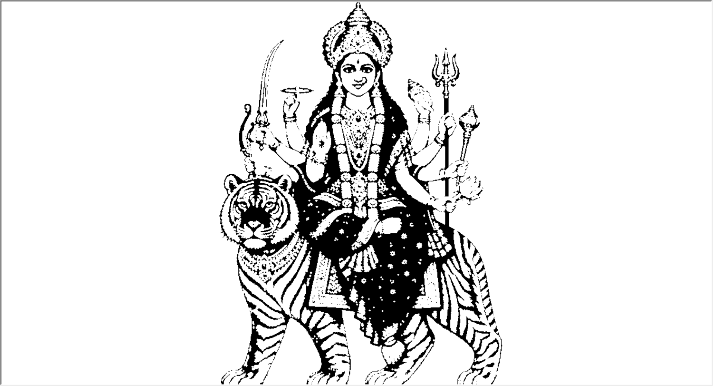

# 🪷 Durga Maa Turtle Art

### A devotional drawing project powered by Python and Computer Vision

Transform a reference image of Durga Maa into a black-and-white contour drawing using Python Turtle Graphics and OpenCV.

This project combines image processing, contour detection, and computer graphics to recreate intricate devotional artwork through a live drawing animation.

## 🖼️ Preview



## ✨ Features

* **Image Processing:** Convert the reference image into grayscale and binary formats.
* **Contour Detection:** Detect outlines and nested shapes using OpenCV.
* **Layered Drawing:** Render contours according to their nesting depth.
* **Live Animation:** Watch Turtle Graphics draw the detected shapes.
* **Adjustable Resolution:** Control the drawing size while preserving the image's aspect ratio.
* **Simple Setup:** Run locally with Python and the required packages.

## 🖼️ Project Reference

The program uses `Durga Maa.jpg` as its input image and draws the detected contours in a Turtle graphics window.

## 🛠️ Technologies Used

* Python
* OpenCV
* NumPy
* Turtle Graphics
* Image Processing
* Contour Detection

## 📁 Project Structure

```text

Durga-Maa-Turtle-Art/
├── Durga_Maa_turtle.py
├── Durga Maa.jpg
├── screenshots/
│   └── Durga_Maa_preview.png
├── requirements.txt
├── .gitignore
└── README.md
```

## 🚀 Getting Started

### Prerequisites

* Python 3.10 or later recommended
* pip
* A desktop environment supporting Python Turtle graphics and Tkinter

### 1. Download the repository

Click the green **Code** button on GitHub, then select **Download ZIP**.

Extract the downloaded ZIP file and open the project folder.

Alternatively, clone the repository:

```bash
git clone https://github.com/Udaysri2025/Durga-Maa-Turtle-Art.git
cd Durga-Maa-Turtle-Art
```

Replace `Udaysri2025` with your GitHub username.

### 2. Install dependencies

Open a terminal in the project folder and run:

```bash
python -m pip install -r requirements.txt
```

On Windows, you can also use:

```bash
py -m pip install -r requirements.txt
```

### 3. Run the program

```bash
python Durga_Maa_turtle.py
```

On Windows:

```bash
py Durga_Maa_turtle.py
```

The Turtle graphics window will open and begin drawing the detected contours.

## ⚙️ How It Works

1. **Load:** Read the reference image in grayscale.
2. **Resize:** Scale the image to the selected drawing width.
3. **Threshold:** Convert grayscale pixels into a binary image.
4. **Detect:** Extract contours and their hierarchy.
5. **Filter:** Remove small contours to reduce noise.
6. **Organize:** Group contours by nesting depth.
7. **Render:** Draw each contour using alternating black and white fills.

## 🎨 Customization

You can experiment with the following settings in `Durga_Maa_turtle.py`:

| Setting             | Purpose                            |
| ------------------- | ---------------------------------- |
| `image_path`        | Input image filename               |
| `target_width`      | Drawing width                      |
| Threshold value     | Controls binary conversion         |
| `cv2.RETR_TREE`     | Retrieves nested contour hierarchy |
| Contour area filter | Removes tiny shapes                |
| `pen.pensize()`     | Controls outline thickness         |

The final appearance depends on image contrast, threshold selection, contour complexity, and drawing resolution.

## 🔮 Future Improvements

* Automatic threshold selection
* Image denoising and edge enhancement
* Adjustable drawing speed
* Contour simplification for faster rendering
* PNG and SVG export
* Interactive controls for selecting reference images

## 👨‍💻 Author

**UDAY SRI YARAMATI**

GitHub: [@Udaysri2025](https://github.com/Udaysri2025)

## 📄 License

No license has been selected yet. Please check the repository's licensing information before reusing or redistributing this project.

---

*Created with Python, computer vision, and creativity.*
